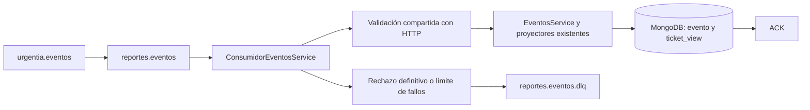

# Consumidor de reporting · entrega 2 · P6

## Configuración

El servicio lee una única variable, `RABBITMQ_URL`, con la URL completa AMQP.
El Compose raíz de P1 ya la proporciona y espera a que termine
`rabbitmq-topologia`. P6 no declara exchanges, colas ni bindings y no requiere
modificaciones en ese Compose. Usa:

| Recurso              | Valor del contrato                              |
| -------------------- | ----------------------------------------------- |
| Exchange de eventos  | `urgentia.eventos` (topic)                      |
| Cola consumida       | `reportes.eventos` (quorum, durable)            |
| Binding              | `#`                                             |
| DLQ                  | `reportes.eventos.dlq`                          |
| Exchange de errores  | `urgentia.dlx`                                  |
| Máximo de fallos     | `x-delivery-limit=5`, administrado por RabbitMQ |
| Entregas simultáneas | `prefetch(10)`, ACK manual por mensaje          |

Desde el IDE se usan las credenciales del `.env` raíz y el host `localhost:5672`;
dentro de Compose, `rabbitmq:5672`. Completar la línea comentada en el
`.env.example` de este servicio al preparar el `.env` local. No incluir la URL
con credenciales en commits. Los errores de conexión se registran sin su valor.

Si falta `RABBITMQ_URL`, el consumidor queda deshabilitado y se informa en el log.
Esto permite conservar la demo HTTP de P6. Una URL con protocolo incorrecto
produce un error de configuración al arrancar. Si el broker está caído, el
consumidor reintenta cada cinco segundos; las consultas a MongoDB siguen
disponibles. `/health` verifica MongoDB; para comprobar AMQP, revisar el log
`Consumiendo reportes.eventos con prefetch 10` y el consumidor en la consola de
RabbitMQ de desarrollo (`http://localhost:15672`).

## Procesamiento



El adaptador decodifica JSON UTF-8 y aplica el mismo `ValidationPipe` que HTTP:
versión, enums, UUID, fechas, campos requeridos y rechazo de campos extra. Después
llama al `EventosService` existente, que valida las reglas del payload, registra
el evento original como `PENDIENTE`, actualiza la vista y marca `PROCESADO`.

- **Éxito o duplicado:** ACK después de completar la persistencia. La clave única
  `eventId` y los upserts existentes conservan la idempotencia. Un evento anterior
  a `ultimoEventoEn` se registra sin sobrescribir el snapshot más reciente.
- **JSON, esquema o regla de negocio inválidos:** `reject(mensaje, false)` para
  enviar a la DLQ sin reintentar una entrada que no puede procesarse.
- **Error de persistencia o procesamiento:** `reject(mensaje, true)` solicita
  reentrega. La cola quorum cuenta los fallos y, al superar su límite, envía el
  mensaje a la DLQ. P6 no mantiene contadores ni colas de reintento propias.
- **Corte de conexión o ACK perdido:** se vuelve a consumir tras reconectar;
  una eventual repetición se resuelve con el registro persistido de `eventId`.
- **Apagado:** cancela nuevas entregas, espera hasta diez segundos por los
  mensajes que se están procesando y cierra canal/conexión. Los mensajes sin ACK
  quedan disponibles para redelivery.

El `correlationId` del sobre acompaña la validación y el procesamiento en los
logs JSON. Para un JSON inválido se usa la propiedad AMQP de correlación si está
presente. No se registran el cuerpo completo ni las credenciales.

Se usa `basic.reject` como confirmación negativa individual. Desde RabbitMQ 4.3,
`basic.nack` ya no incrementa el contador de fallos de las colas quorum; usarlo
para estos errores permitiría reintentos sin alcanzar `x-delivery-limit`.
`basic.reject` conserva el comportamiento requerido tanto con el contrato
declarado sobre RabbitMQ 4.1 como con la imagen `rabbitmq:4-management` actual.
Ver [Negative Acknowledgements](https://www.rabbitmq.com/docs/nack) y
[Poison Message Handling](https://www.rabbitmq.com/docs/quorum-queues#poison-message-handling).

No se modifican los endpoints de reportes ni el contrato OpenAPI. El endpoint
interno `POST /api/eventos` permanece para compatibilidad; la entrada AMQP usa
exactamente el mismo procesamiento. La entrega real de eventos depende del
publicador Outbox de ticket-service de P2.

## Pruebas reproducibles

Requisitos: Node 20, dependencias de este servicio y Docker Desktop. Desde la
raíz del backend, con el `.env` del equipo configurado:

```bash
docker compose up -d --wait rabbitmq-topologia
cd reporting-service
npm ci
npm run typecheck
npm run build
npm test
npm run test:e2e
```

Para el test real de AMQP, definir `RABBITMQ_URL` apuntando a `localhost:5672`
con un usuario administrador del broker de desarrollo y ejecutar:

```bash
npm run test:rabbitmq
```

También puede leerse del `.env` local sin exportar variables:

```bash
node --env-file=.env node_modules/jest/bin/jest.js --config test/jest-rabbitmq.json --runInBand
```

`RABBITMQ_MANAGEMENT_URL` es opcional y **solo del test**; por defecto se usa
`http://<host-de-RABBITMQ_URL>:15672`. Sirve si la consola publica otro puerto.
El test crea un vhost `reporting-test-<UUID>`, carga allí una copia de la topología
compartida y lo elimina al finalizar. Usa MongoDB 7.0.24 real y temporal,
descargado en la primera ejecución. No usa las colecciones ni las colas del
entorno del equipo. Las pruebas HTTP deshabilitan explícitamente el consumidor
para que una variable exportada no haga que consuman mensajes ajenos.

La suite AMQP cubre:

1. Los seis tipos de evento y sus resultados consultados por la API.
2. Doce duplicados concurrentes y un evento antiguo posterior al más reciente.
3. JSON roto, versión inválida y reglas de negocio incumplidas, con DLQ real.
4. Fallo inyectado al marcar `PROCESADO`, después de escribir la vista: reentrega
   y recuperación del evento `PENDIENTE`, sin duplicar el ticket.
5. Fallo persistente: primera entrega más cinco reentregas y DLQ con razón
   `delivery_limit`. Esto también comprueba la elección de `basic.reject`.
6. Cierre de la conexión por el broker, reconexión y recepción de otro evento.

Las pruebas unitarias verifican además que no haya ACK antes de persistir,
prefetch, correlación, UTF-8 inválido, credenciales ausentes de logs, fallos de
conexión, cancelación del consumidor, ACK fallido y apagado con tareas pendientes.

Validación local de esta implementación: Node 20, RabbitMQ 4.4.0 y MongoDB
standalone 7.0.24. El job HTTP existente no requiere cambios; para añadir esta
suite al CI, P1 debe disponer un broker con management y pasar sus credenciales
por variables de entorno antes de `npm run test:rabbitmq`.

## Coordinación

Esta parte de P6 permite que P1 incorpore reporting a la prueba integral por cola
y al manual, una vez que el cambio se publique y se integre en `dev/entrega-2`.
La prueba completa ticket → Outbox → RabbitMQ → reporting necesita además el
publicador de P2; el flujo de clasificación necesita los componentes de P2/P3.
El consumidor de P6 puede probarse de forma independiente con la suite anterior.
